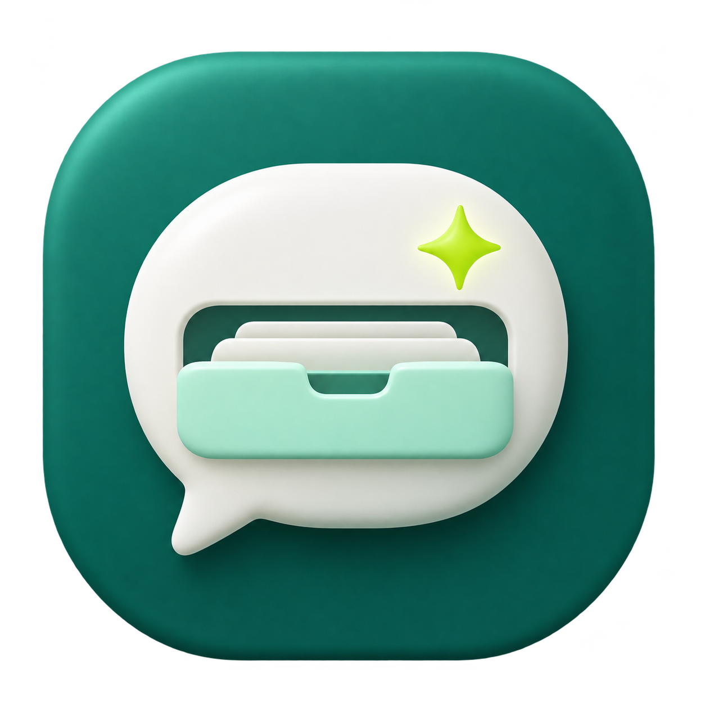

<p align="center"></p>

# WXStorageCleanUp

macOS 微信存储整理工具：查看空间占用，按聊天、消息或未归属附件清理，支持多账号切换。独立第三方项目，非微信官方产品。

## 下载安装

**v0.3.2 预览版 · 最低部署版本 macOS 14.0。** 在苹果菜单 →「关于本机」查看芯片，选择对应安装包：

| 芯片 | 下载 |
| --- | --- |
| Intel | [Intel DMG（x86_64）](https://github.com/xbzzoo/WXStorageCleanUp/releases/download/v0.3.2/WXStorageCleanUp-0.3.2-macOS-x86_64.dmg) |
| Apple M 系列 | [Apple Silicon DMG（arm64）](https://github.com/xbzzoo/WXStorageCleanUp/releases/download/v0.3.2/WXStorageCleanUp-0.3.2-macOS-arm64.dmg) |

ZIP、SHA-256 校验文件及更新说明见 [Release](https://github.com/xbzzoo/WXStorageCleanUp/releases/tag/v0.3.2)。Intel 无法运行 arm64 包，架构不匹配时更换安装包即可。

1. 打开 DMG，将 `WXStorageCleanUp.app` 拖入 **Applications（应用程序）**，复制后推出磁盘映像。
2. 从「应用程序」启动。预览版尚未 Apple 公证；若被拦截，尝试打开后在「系统设置 → 隐私与安全性」点击「仍要打开」，详见 [Apple 说明](https://support.apple.com/zh-cn/102445)。
3. 点击「扫描本机微信」。需要聊天名称和消息归属时，打开「连接聊天索引」并选择账号。
4. 选择附件、核对预览，退出微信后清理。

首次自动连接需 Xcode 或 Command Line Tools（`xcode-select --install`），并需本人在临时微信窗口完成登录确认，请提前保存草稿。扫描及手动整理附件无需 Homebrew 或开发工具。

升级前退出旧版并替换应用；从「微空间」升级后删除旧 `微空间.app`，账号连接和操作记录保留。

## 使用须知

- **清理仅移入废纸篓，核对并清空相应项目后才可能释放空间。** 清空后无法通过本工具恢复；共享硬链接、APFS 快照等可能继续占用空间。
- 保留文字消息和微信数据库；未归属附件可能仍被聊天使用，请按需选择。总占用与聊天附件统计口径不同。
- 聊天数据和密钥仅在本机处理。Intel 版已在 Rosetta 下验证，Intel 真机及 macOS 14 / 15 尚未实机回归。

## 源码运行

需要 Swift 5.10+ 和 Xcode 开发工具：

```sh
swift run WXStorageCleanUp
swift test
python3 scripts/package_app.py --arch x86_64  # Apple Silicon 改为 arm64
```

打包会下载并校验依赖源码，生成应用、DMG 和 ZIP；首次构建需数分钟。

[验证记录](docs/validation.md) · [发布说明](docs/releases/v0.3.2.md) · [图标设计](docs/icon-design.md)
